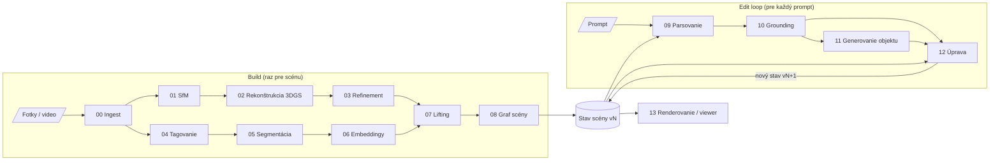

# Generovanie 3D scén na základe textových promptov

Bakalárska práca, FMFI UK Bratislava, Aplikovaná informatika.
Autor: Šimon Hajkovský · Školiteľ: doc. RNDr. Martin Madaras, PhD.

## Cieľ projektu

Z obyčajných fotiek alebo videa reálnej scény (napríklad izby) vytvoriť jej **fotorealistickú
3D verziu**, ktorej **rozumieme po objektoch** a ktorú sa dá **upravovať textom alebo obrázkom**.
Napríklad:

> „zmeň farbu gauča na modrú“ · „odstráň lampu“ · „vymeň stôl za takýto“ + fotka

Scéna je reprezentovaná dvoma prepojenými vrstvami:

- **geometrická vrstva**: 3D Gaussian Splatting, teda milióny malých 3D gaussiánov, ktoré sa dajú
  renderovať v reálnom čase z ľubovoľného uhla,
- **symbolická vrstva**: graf scény, kde uzly sú objekty (label, popis, poloha) a hrany sú vzťahy
  medzi nimi (*na*, *vedľa*, *vnútri*).

Prompt sa najprv namapuje na uzol grafu a až potom sa úprava vykoná nad gaussiánmi, ktoré
k tomuto objektu patria.

Projekt nevymýšľa novú metódu pre každý krok. Skladá reťazec z existujúcich open-source nástrojov
a dopĺňa vlastné moduly tam, kde hotové riešenie chýba (prenos masiek na gaussiány, router úprav).
Všetky použité moduly musia byť **free to use**; primárna implementácia každej fázy je
open source s permisívnou licenciou, nekomerčné nástroje slúžia iba ako alternatívy a na porovnanie. Každá fáza je **samostatne vymeniteľný
modul** s pevne definovaným vstupom a výstupom.

## Pipeline



Diagram je zjednodušený. Úplný graf závislostí (napríklad že lifting potrebuje aj kamery zo SfM
a masky zo segmentácie) je v [`phases/README.md`](phases/README.md).

## Fázy

### Build: z fotiek na upraviteľnú scénu

| # | Fáza | Čo robí | Hlavný nástroj |
|---|---|---|---|
| 00 | **Ingest** | Zjednotí vstup: z videa vyberie snímky, vyradí rozmazané a duplicitné, zmenší rozlíšenie. | OpenCV, ffmpeg |
| 01 | **Structure-from-Motion** | Zistí, kde stála kamera pri každej snímke, a vytvorí riedky 3D pointcloud. Scénu natočí tak, aby +Z mierilo hore. | COLMAP 4 |
| 02 | **Rekonštrukcia** | Natrénuje 3D Gaussian Splatting: fotorealistickú scénu renderovateľnú v reálnom čase. | gsplat |
| 03 | **Refinement** | Vyčistí natrénované gaussiány: odstráni floatery, takmer priehľadný „opar“ a ihlicovité artefakty. | vlastný kód nad gsplat |
| 04 | **Tagovanie** | Zistí, aké objekty sa v scéne vyskytujú, a vytvorí z nich slovník pre detektor. | RAM++ |
| 05 | **Segmentácia** | Nájde objekty zo slovníka na každej snímke a vytvorí ich presné masky. Ten istý objekt sleduje naprieč snímkami. | Grounding DINO + SAM 2 |
| 06 | **Embeddingy** | Ku každej maske vypočíta CLIP vektor, vďaka ktorému sa dá objekt neskôr nájsť podľa ľubovoľného textu. | OpenCLIP |
| 07 | **Lifting 2D → 3D** | Prenesie 2D masky na gaussiány: každý gaussián dostane objekt, ku ktorému patrí. Vlastný modul. | vlastný kód nad gsplat |
| 08 | **Graf scény** | Z objektov postaví graf: bounding boxy, popisy objektov a vzťahy ako *na* alebo *vedľa*. | vlastný kód + Qwen2.5-VL |

### Edit loop: úprava promptom

| # | Fáza | Čo robí | Hlavný nástroj |
|---|---|---|---|
| 09 | **Parsovanie promptu** | Preloží voľný text na štruktúrovaný plán: typ operácie, popis cieľa, parametre. | lokálny LLM (Qwen) |
| 10 | **Grounding** | Nájde v grafe konkrétny objekt, ktorého sa prompt týka („pohár *na stole*“, „*ľavá* stolička“). | CLIP + graf |
| 11 | **Generovanie objektu** | Pri výmene alebo vložení vytvorí nový 3D objekt z textu alebo obrázka. | FLUX.1-schnell + TRELLIS |
| 12 | **Úprava** | Vykoná plán nad gaussiánmi a grafom. Každá operácia (farba, odstránenie, presun, výmena, vloženie, štýl) má vlastný operátor. Diery po objektoch dopĺňa inpaintingom. | vlastné operátory + LaMa |
| 13 | **Renderovanie** | Zobrazí ľubovoľný stav scény: rendery, video, porovnanie pred a po, interaktívny viewer. | gsplat + viser |

Každá úprava vytvorí nový **stav scény** (`v000`, `v001`, …). Vďaka tomu sa dá vrátiť k staršiemu
stavu alebo porovnať výsledok pred a po úprave.

Podrobná špecifikácia každej fázy (vstupy, výstupy, postup, alternatívy, licencie, hardvér,
evaluácia) je v priečinku [`phases/`](phases/).

## Princíp modularity

- Fázy si odovzdávajú dáta **iba cez súbory** v `workspace/<scena>/` v presne definovaných
  formátoch ([`docs/data-contracts.md`](docs/data-contracts.md)).
- Každá fáza môže mať viac implementácií (napr. SfM cez COLMAP alebo VGGT). Ktorá sa použije,
  určuje [`configs/default.yaml`](configs/default.yaml).
- Každá fáza zapíše `manifest.json`: čím, s akými parametrami a z akých vstupov vznikol výsledok.

## Štruktúra repozitára

```
phases/         špecifikácia každej fázy (zdroj pravdy pre vstupy a výstupy)
docs/           dátové kontrakty, licencie, evaluácia
configs/        konfigurácia fáz
envs/           Python prostredia podľa skupín fáz
src/scenepipe/  kód: core/ (spoločné jadro), phases/ (jeden balík na fázu), monitor/ (sledovanie behu)
tests/          kontraktové a jednotkové testy
```

## Inštalácia

Zatiaľ nie je hotová. Fázy majú navzájom konfliktné závislosti, preto pobežia v oddelených
prostrediach podľa skupín ([`envs/README.md`](envs/README.md)). Spoločné jadro:

```bash
pip install -e ".[dev]"
pytest
```

## Sledovanie behu

```bash
pip install -e ".[monitor]"                  # CustomTkinter
python run_monitor.py                        # alebo dvojklik na run_monitor.py v koreni projektu
```

Okno má tri časti:

- **vľavo** zoznam vstupov (scény vo `workspace/` s ich videami a fotkami), tlačidlo
  „+ Nový vstup…“ (vyberieš video alebo fotky, zadáš názov scény, súbory sa skopírujú do
  `workspace/<scéna>/input/`), výber profilu (plný / rýchly), fázy, od ktorej sa začne,
  a tlačidlá **Spustiť** / **Zastaviť**. Spustenie pustí za sebou všetky implementované
  build fázy ako samostatné procesy; výstup každej je v `workspace/<scéna>/logs/<fáza>.log`,
- **v strede** graf fáz (bežiaca fáza je zvýraznená, kliknutie na uzol ukáže jej riadok),
- **vpravo** priebeh každej fázy (percentá, krok, uplynulý čas, odhad konca, hlavné čísla
  z reportu).

Ktorá fáza beží v ktorom Python prostredí (napr. 02 vo WSL), je v `configs/local.yaml`
(necommituje sa; vzor `configs/local.example.yaml`). Bez neho bežia všetky fázy v aktuálnom
Pythone. Priebeh sa číta zo súborov `progress.json`, `manifest.json` a `report.json`, takže
okno ukazuje aj fázy spustené inak (z príkazového riadka, na inom stroji so zdieľaným diskom).

Jednu fázu spustíš aj bez okna: `python -m scenepipe run 02_reconstruction --scene izba --profile fast`.

## Ďalšie dokumenty

- [`CLAUDE.md`](CLAUDE.md): pravidlá a workflow pre vývoj s Claude Code
- [`docs/licenses.md`](docs/licenses.md): licencie všetkých nástrojov a modelov
- [`docs/evaluation.md`](docs/evaluation.md): metriky a datasety
