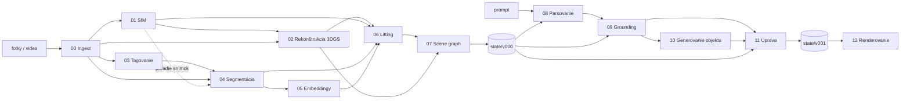

# Fázy reťazca: prehľad

Reťazec je rozdelený na 13 fáz. Oproti pôvodnému návrhu (6 fáz v ročníkovom projekte) sú
zmeny tieto:

- **Rekonštrukcia 3DGS je presunutá dopredu** (fáza 02). Úprava aj lifting pracujú nad
  gaussiánmi, takže gaussiány musia existovať skôr. Na konci ostáva len renderovanie (12).
- **2D segmentácia je rozdelená na tri fázy** (03 tagovanie, 04 segmentácia, 05 embeddingy),
  aby sa tagger, segmentátor a príznakový model dali vymeniť nezávisle.
- **Lifting ide priamo na gaussiány** (06), nie na riedky SfM pointcloud.
- **Úprava promptom je rozdelená na štyri fázy**: parsovanie promptu (08), grounding cieľa
  v grafe (09), generovanie nového objektu (10) a samotná úprava (11).

| # | Fáza | Časť | Vstup (hlavný) | Výstup (hlavný) | Primárna implementácia |
|---|---|---|---|---|---|
| 00 | [Ingest](00_ingest.md) | build | fotky / video | normalizované snímky + `frames.json` | vlastný kód (OpenCV, ffmpeg) |
| 01 | [SfM](01_sfm.md) | build | snímky | kamery + riedky pointcloud (COLMAP + `cameras.json`) | COLMAP 4.x |
| 02 | [Rekonštrukcia](02_reconstruction.md) | build | snímky + kamery + pointcloud | `gaussians.ply` | gsplat |
| 03 | [Tagovanie](03_tagging.md) | build | snímky | slovník objektov `tags.json` | RAM++ |
| 04 | [Segmentácia](04_segmentation.md) | build | snímky + slovník | masky inštancií + `detections.json` | Grounding DINO + SAM 2 |
| 05 | [Embeddingy masiek](05_mask_embedding.md) | build | snímky + masky | CLIP vektor pre každú masku | OpenCLIP |
| 06 | [Lifting](06_lifting.md) | build | gaussiány + kamery + masky + embeddingy | inštancia pre každý gaussián | vlastný kód (gsplat) |
| 07 | [Scene graph](07_scene_graph.md) | build | gaussiány + inštancie + snímky | `scene_graph.json` | vlastný kód + Qwen2.5-VL |
| 08 | [Parsovanie promptu](08_prompt_parsing.md) | edit | prompt + graf | `edit_plan.json` (nevyriešené ciele) | Qwen (LLM) |
| 09 | [Grounding](09_grounding.md) | edit | plán + graf + embeddingy | plán s ID uzlov | vlastný kód (CLIP + graf) |
| 10 | [Generovanie objektu](10_asset_generation.md) | edit | text / obrázok | `asset.ply` v kanonickom tvare | FLUX.1-schnell + TRELLIS |
| 11 | [Úprava](11_editing.md) | edit | stav `vN` + plán + assety | stav `vN+1` | vlastné operátory + LaMa + gsplat |
| 12 | [Renderovanie](12_rendering.md) | obe | stav + kamery | snímky / video / viewer | gsplat + viser |

## DAG závislostí

Fázy 03 → 04 → 05 nezávisia od 02, dajú sa teda spustiť paralelne s tréningom gaussiánov.

## Stav scény

Výstup buildu aj každej úpravy je **stav scény** (`state/vNNN/state.json`), ktorý ukazuje na
štyri súbory: gaussiány, priradenie gaussiánov k inštanciám, graf scény a príznaky uzlov.
Fázy 08–12 čítajú a zapisujú výhradne stavy. Podrobne v `docs/data-contracts.md`.

## Poradie implementácie (odporúčané)

1. **00 → 01 → 02 → 12**: najprv funkčná fotorealistická scéna, ktorú vieš pozrieť vo vieweri.
   Všetko „out of the box“, overí to prostredie a hardvér.
2. **03 → 04 → 05**: 2D sémantika, dá sa ladiť na jednotlivých obrázkoch.
3. **06 → 07**: jadro sémantickej vrstvy, vlastný kód.
4. **08 → 09 → 11** (operátory recolor, delete, transform): prvé úpravy bez generatívnych modelov.
5. **10 → 11** (operátory replace, insert, style): generatívna časť, najnáročnejšia na hardvér.

## Šablóna dokumentu fázy

Každý `XX_*.md` má rovnaké sekcie: Účel, Kontrakt (vstupy, výstupy, `contract_version`),
Postup, Implementácie (primárna a alternatívy s licenciami), Konfigurácia, Hardvér,
Validácia výstupu, Riziká a otvorené otázky, Evaluácia, Stav, Zdroje.
